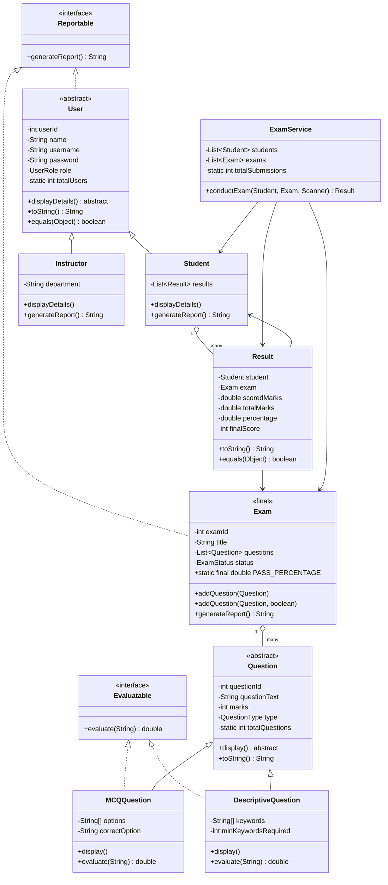
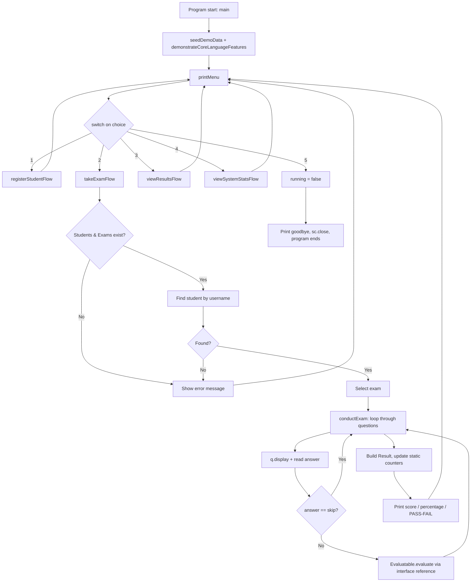

# Online Examination Management System

A console-based Java OOP mini-project. Compiles and runs with plain `javac` / `java` — no external
libraries required.

## How to compile and run

```bash
# From the project root (the folder containing "src")
javac -d out $(find src -name "*.java")
java -cp out com.exam.main.Main
```

## Project structure

```
OnlineExamSystem/
└── src/
    └── com/
        └── exam/
            ├── model/
            │   ├── UserRole.java
            │   ├── QuestionType.java
            │   ├── ExamStatus.java
            │   ├── User.java              (abstract)
            │   ├── Student.java
            │   ├── Instructor.java
            │   ├── Question.java          (abstract)
            │   ├── MCQQuestion.java
            │   ├── DescriptiveQuestion.java
            │   ├── Exam.java              (final)
            │   └── Result.java
            ├── service/
            │   ├── Evaluatable.java       (interface)
            │   ├── Reportable.java        (interface)
            │   └── ExamService.java
            └── main/
                └── Main.java
```

Two custom packages beyond `main` (`com.exam.model` and `com.exam.service`), satisfying the
"at least 2 packages" requirement, plus the entry-point package `com.exam.main`.

---

## Traceability Report — 21 Mandatory Features

| # | Feature | Package.Class | Method / Location |
|---|---------|----------------|--------------------|
| 1 | Encapsulation | `com.exam.model.User`, `Student`, `Question`, `Exam`, `Result` | private fields + public getters/setters throughout |
| 2 | Data types, final constants, scope | `com.exam.model.Exam.PASS_PERCENTAGE` (final constant); `com.exam.main.Main.APP_NAME` (final, static scope); local vars in `Main.main()` vs instance fields in `User` | Field declarations + comments tagged `REQUIREMENT 2` |
| 3 | Operators & precedence | `com.exam.main.Main.demonstrateCoreLanguageFeatures()` | `int precedenceResult = 10 + 20 * 2 - 9 % 4;` |
| 4 | Casting | `com.exam.model.Result` constructor; `com.exam.model.MCQQuestion.display()`; `com.exam.main.Main.demonstrateCoreLanguageFeatures()` | `(int) this.percentage`, `(char) ('A' + i)`, `(int) rawPercentage` |
| 5 | Enum | `com.exam.model.UserRole`, `QuestionType`, `ExamStatus` | Whole files |
| 6 | Control flow (if-else, switch, loops, break, continue, return) | `com.exam.main.Main.main()` (switch, while), `ExamService.conductExam()` (for, continue), `findStudentByUsername()` (return) | See inline `REQUIREMENT 6` comments |
| 7 | Object arrays / collections | `com.exam.model.MCQQuestion.options` (`String[]`), `Exam.questions` (`List<Question>`), `Main.sampleUsers` (`User[]`) | Field declarations |
| 8 | Formatted I/O | `com.exam.main.Main` (Scanner + `System.out.printf`), `Result.toString()` | Throughout |
| 9 | Constructor overloading | `User`, `Student`, `Instructor`, `Question`, `Exam`, `Result` | Each has a default + parameterized constructor |
| 10 | Method overloading | `com.exam.model.Exam.addQuestion(Question)` / `addQuestion(Question, boolean)` | `Exam.java` |
| 11 | Static members | `User.totalUsers` / `getTotalUsers()`, `Question.totalQuestions`, `Exam.totalExams`, `ExamService.totalSubmissions`, `Main.menuVisits` | Each class |
| 12 | `this` keyword | `User(String,...)` constructor (shadowing), `User()`, `Question()`, `Exam()` (constructor chaining via `this(...)`) | Constructors |
| 13 | String methods | `equalsIgnoreCase`, `trim`, `contains`, `split`, `toLowerCase` | `MCQQuestion.evaluate()`, `DescriptiveQuestion.evaluate()`, `ExamService`, `Main.demonstrateCoreLanguageFeatures()` |
| 14 | Inheritance hierarchy | `User → Student, Instructor`; `Question → MCQQuestion, DescriptiveQuestion` | `com.exam.model` |
| 15 | `super` keyword | Every subclass constructor (`super(...)`), `Student.generateReport()` / `Instructor.generateReport()` (`super.generateReport()`) | `Student.java`, `Instructor.java`, `MCQQuestion.java`, `DescriptiveQuestion.java` |
| 16 | Dynamic binding & overriding | `Main.demonstrateCoreLanguageFeatures()` (`User[]` holding `Student`/`Instructor`); `ExamService.conductExam()` (`Question` reference calling overridden `display()`/`evaluate()`) | See `REQUIREMENT 16` comments |
| 17 | Abstract class | `com.exam.model.User` (abstract `displayDetails()`), `com.exam.model.Question` (abstract `display()`) | Class declarations |
| 18 | Interface | `com.exam.service.Evaluatable` (implemented by `MCQQuestion`, `DescriptiveQuestion`); `com.exam.service.Reportable` (implemented by `User`, `Exam`); accessed via interface references in `ExamService.conductExam()` and `Main.viewSystemStatsFlow()` | `service` package + usages |
| 19 | Object overriding | `toString()` in `User`, `Question`, `Exam`, `Result`; `equals()`/`hashCode()` in `User`, `Result` | Each class |
| 20 | Final element | `public final class Exam` — marked final so a scheduled exam's structure/grading rules cannot be silently altered by subclassing | `Exam.java` (comment above class) |
| 21 | Custom packages | `com.exam.model`, `com.exam.service`, `com.exam.main` with explicit `import` statements between them | All files |

---

## Text-based UML Class Diagram

```
                        +----------------------+
                        |    <<interface>>      |
                        |     Reportable         |
                        +------------------------+
                        | + generateReport(): String |
                        +------------------------+
                                 ▲        ▲
                                 |        |
                    implements   |        |  implements
                                 |        |
           +---------------------+      +----------------------+
           |   <<abstract>> User  |      |         Exam (final)  |
           +-----------------------+     +------------------------+
           | - userId: int          |     | - examId: int           |
           | - name: String         |     | - title: String         |
           | - username: String     |     | - questions: List<Q>    |
           | - password: String     |     | - status: ExamStatus    |
           | - role: UserRole       |     | + PASS_PERCENTAGE: final|
           | - totalUsers: static   |     +--------------------------+
           +-------------------------+     | + addQuestion(Question)  |
           | + displayDetails(): abstract| | + addQuestion(Q, bool)   |
           | + toString(), equals()  |     | + generateReport()       |
           +-------------------------+     +---------------------------+
                    ▲        ▲
                    |        |  extends
        +-----------+        +-----------+
        |                                |
+----------------+              +--------------------+
|    Student      |              |     Instructor      |
+------------------+             +-----------------------+
| - results: List<Result> |      | - department: String   |
+------------------+             +-----------------------+
| + displayDetails() |            | + displayDetails()     |
| + generateReport() |            | + generateReport()     |
+------------------+             +-----------------------+


                        +--------------------------+
                        |     <<interface>>          |
                        |      Evaluatable            |
                        +------------------------------+
                        | + evaluate(String): double    |
                        +------------------------------+
                                 ▲        ▲
                                 |        |
                    implements   |        |  implements
                                 |        |
                      +-----------------------------+
                      |  <<abstract>> Question         |
                      +-----------------------------------+
                      | - questionId: int                   |
                      | - questionText: String              |
                      | - marks: int                         |
                      | - type: QuestionType                 |
                      | - totalQuestions: static             |
                      +---------------------------------------+
                      | + display(): abstract                 |
                      | + toString()                          |
                      +---------------------------------------+
                    ▲        ▲
                    |        |  extends
        +-----------+        +-----------+
        |                                |
+---------------------+       +---------------------------+
|    MCQQuestion        |      |   DescriptiveQuestion       |
+-------------------------+    +---------------------------------+
| - options: String[]      |    | - keywords: String[]             |
| - correctOption: String  |    | - minKeywordsRequired: int       |
+-------------------------+    +---------------------------------+
| + display()               |   | + display()                      |
| + evaluate(String)         |  | + evaluate(String)                |
+-------------------------+    +---------------------------------+


           Exam "1" o------- "many" Question        (composition: List<Question>)
           Student "1" o---- "many" Result           (composition: List<Result>)
           Result -------> Student, Exam              (association)
           ExamService -------> Student, Instructor, Exam, Result   (manages / uses)
           Main -------> ExamService                  (drives the console flow)
```

Mermaid version (paste into any Mermaid renderer, e.g. GitHub or the Mermaid Live Editor):



---

## Application Workflow Diagram

This shows the end-to-end runtime flow of the program — from startup through the menu loop to
each feature and back — as opposed to the class-structure UML above.

```
                              ┌─────────────────────────┐
                              │   Program Start (main)    │
                              │  - create Scanner, Service │
                              │  - seedDemoData()           │
                              │  - demonstrateCoreLanguage   │
                              │    Features()                │
                              └────────────┬─────────────┘
                                           │
                                           ▼
                              ┌─────────────────────────┐
                     ┌───────▶│        printMenu()        │◀────────────────┐
                     │        └────────────┬─────────────┘                  │
                     │                     │ readInt(sc)                    │
                     │                     ▼                                │
                     │        ┌─────────────────────────┐                  │
                     │        │      switch(choice)       │                  │
                     │        └───┬────┬────┬────┬────┬──┘                  │
                     │            │1   │2   │3   │4   │5                    │
                     │            ▼    ▼    ▼    ▼    ▼                     │
                     │   ┌────────┐┌───────┐┌───────┐┌────────┐┌─────────┐  │
                     │   │Register││ Take  ││ View  ││ System ││  Exit   │  │
                     │   │Student ││ Exam  ││Results││ Stats  ││(running │  │
                     │   │ Flow   ││ Flow  ││ Flow  ││ Flow   ││=false)  │  │
                     │   └───┬────┘└───┬───┘└───┬───┘└───┬────┘└────┬────┘  │
                     │       │         │        │        │           │      │
                     └───────┴─────────┴────────┴────────┘           │      │
                                    (loop back to menu)               │      │
                                                                       ▼      │
                                                              ┌──────────────┐│
                                                              │ Print Goodbye││
                                                              │  sc.close()   ││
                                                              │  Program Ends ││
                                                              └──────────────┘│
                                                                              │
                              (while(running) keeps looping until choice 5)──┘
```

### Zoom-in: "Take an Exam" flow (option 2)

```
 takeExamFlow(sc, service)
        │
        ▼
 Any students registered? ──No──▶ print "register first" ──▶ return to menu
        │Yes
        ▼
 Any exams available? ──No──▶ print "no exams available" ──▶ return to menu
        │Yes
        ▼
 Prompt username ──▶ findStudentByUsername()
        │
   found? ──No──▶ print "student not found" ──▶ return to menu
        │Yes
        ▼
 List all exams ──▶ Prompt exam number ──▶ valid choice? ──No──▶ error ──▶ return
        │Yes
        ▼
 service.conductExam(student, exam, sc)
        │
        ▼
   for each Question in exam.getQuestions():
        │
        ├─ q.display()                      (dynamic binding: MCQ vs Descriptive look different)
        ├─ read answer from Scanner
        ├─ answer == "skip"? ──Yes──▶ continue (skip scoring, keep marks possible)
        │        │No
        │        ▼
        ├─ Evaluatable evaluator = q;
        ├─ marksAwarded = evaluator.evaluate(answer)   (interface reference, runtime dispatch)
        └─ accumulate totalScored / totalPossible
        │
        ▼
   totalSubmissions++ (static counter)
   new Result(...) created, stored in ExamService + Student
        │
        ▼
   Print score, percentage, final score, PASS/FAIL
        │
        ▼
   Return to main menu
```

Mermaid flowchart version:



---

## Sample Console Output 

```
=============================================
 Online Examination Management System
=============================================
Added question to "Core Java Basics": Explain, in your own words, what an abstract method is.

[Startup self-check of core language features]
Operator precedence demo (10 + 20*2 - 9%4) = 49
Casting demo: 87.65 (double) cast to int -> 87
Dynamic binding demo (User[] holding Student & Instructor objects):
Student -> Name: Demo Student    Username: demo       Exams Taken: 0
Instructor -> Name: Demo Instructor Department: Mathematics
Parsed skills via String.split(): Java | OOP | Collections | Exceptions

--------------- MAIN MENU ---------------
1. Register a new student
2. Take an exam
3. View my results
4. View system statistics (Admin)
5. Exit
Enter your choice: 1
Enter your full name: Asha Kumar
Choose a username: asha
Choose a password: asha123
Registration successful! Welcome, Asha Kumar (User ID: 4)

--------------- MAIN MENU ---------------
Enter your choice: 2
Enter your username: asha

Available exams:
  1. Core Java Basics (2 questions, 15 marks)
Select an exam number: 1

Starting exam: Core Java Basics
--------------------------------------------
Q1 [MCQ | 5 marks] Which OOP pillar hides internal state behind getters/setters?
     A) Encapsulation
     B) Compilation
     C) Inheritance
     D) Iteration
Your answer (or type 'skip'): A
Q2 [DESCRIPTIVE | 10 marks] Explain, in your own words, what an abstract method is.
     (Type a short written answer)
Your answer (or type 'skip'): An abstract method has no body and forces every subclass to override it with its own implementation.
--------------------------------------------
Exam submitted!
Score: 15.00 / 15.00  (100.00%)  Final Score: 100  Status: PASS

--------------- MAIN MENU ---------------
Enter your choice: 4

---------------- SYSTEM STATISTICS ----------------
Total registered users   : 4
Total questions created  : 2
Total exams created      : 1
Total exam submissions   : 1
Menu visits this session : 3

User Reports (via Reportable interface reference):
 - Report for Asha Kumar (ID: 4) | Role: STUDENT | Exams Taken: 1
 - Report for Dr. Rao (ID: 1) | Role: INSTRUCTOR | Department: Computer Science
 - Exam Report -> Core Java Basics | Total Marks: 15 | Pass Mark: 40.0%

--------------- MAIN MENU ---------------
Enter your choice: 3

----------------- ALL RESULTS -----------------
Result[student=Asha Kumar, exam=Core Java Basics, scored=15.00/15.00, percentage=100.00%, finalScore=100, status=PASS]

--------------- MAIN MENU ---------------
Enter your choice: 5

Thank you for using Online Examination Management System. Goodbye!
```
OUTPUT SCREENSHOTS:


